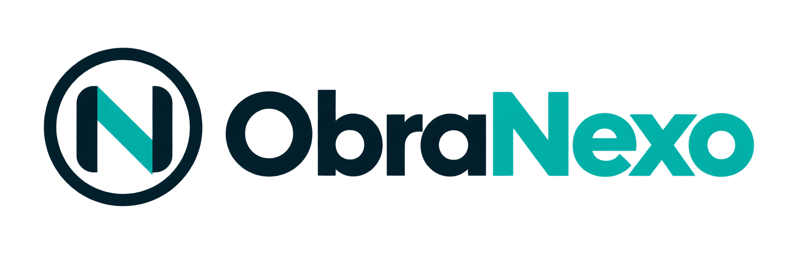
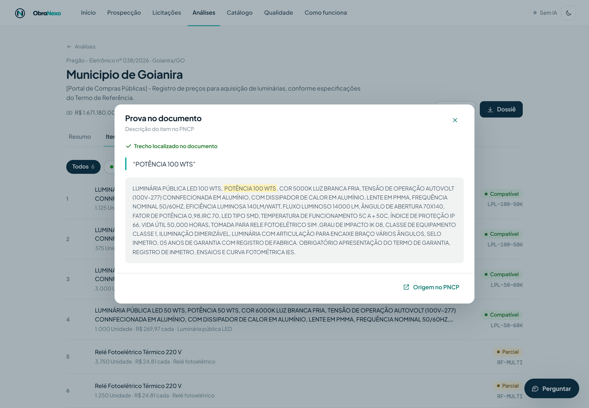
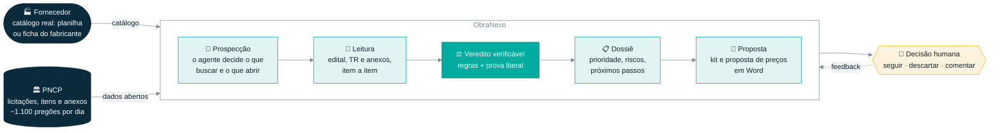
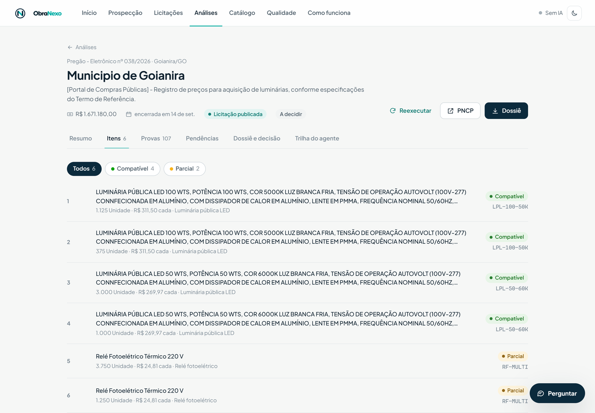
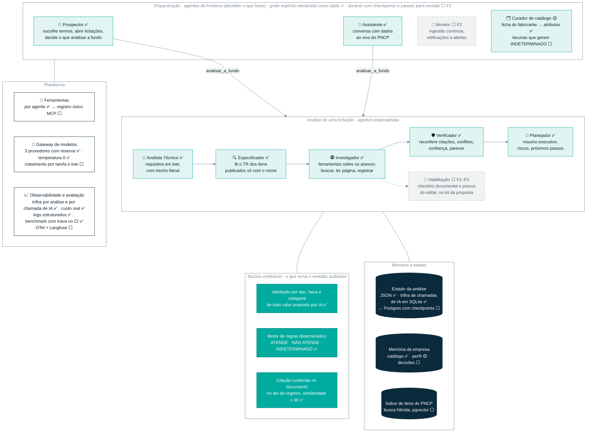
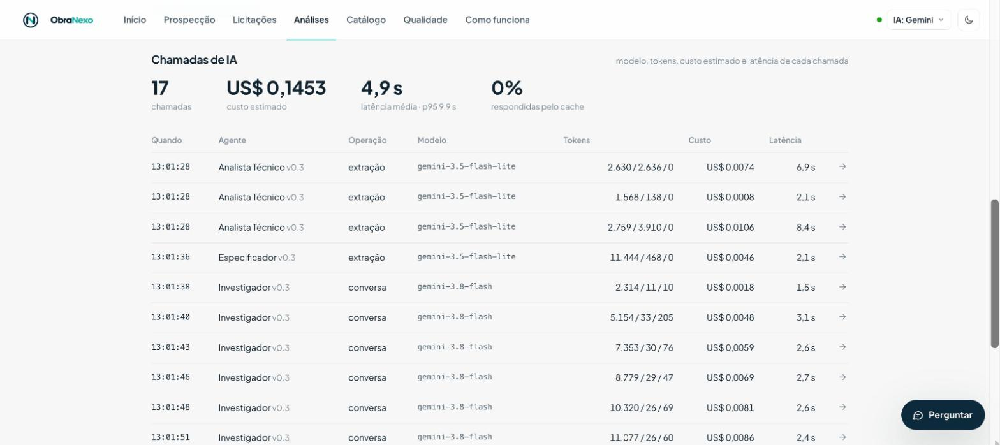
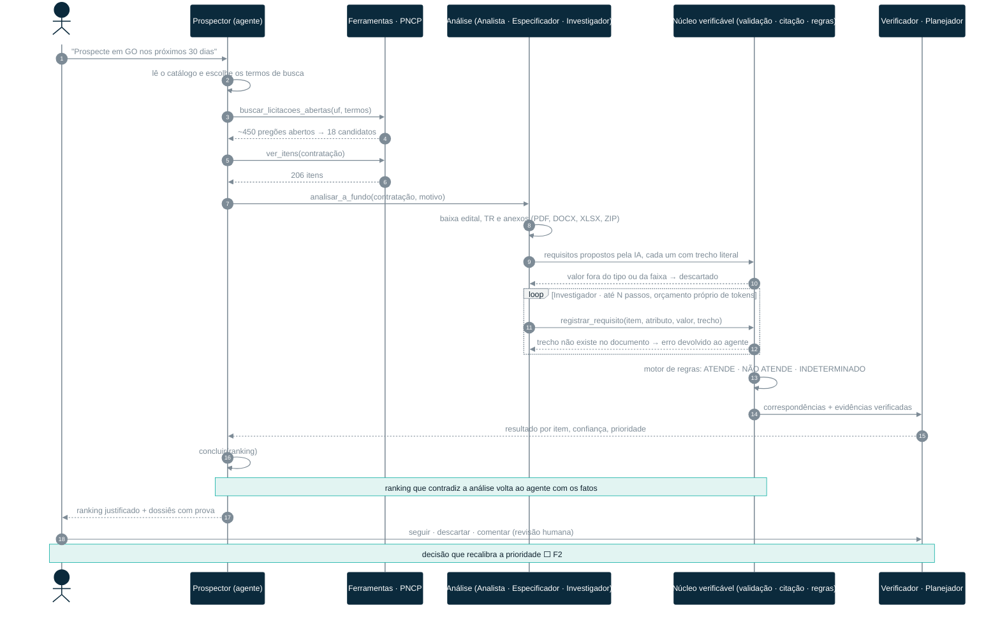
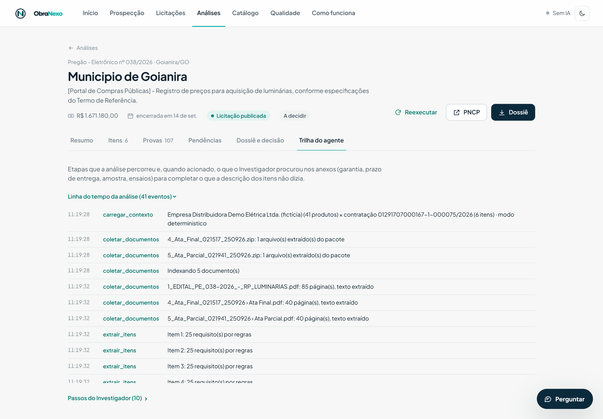
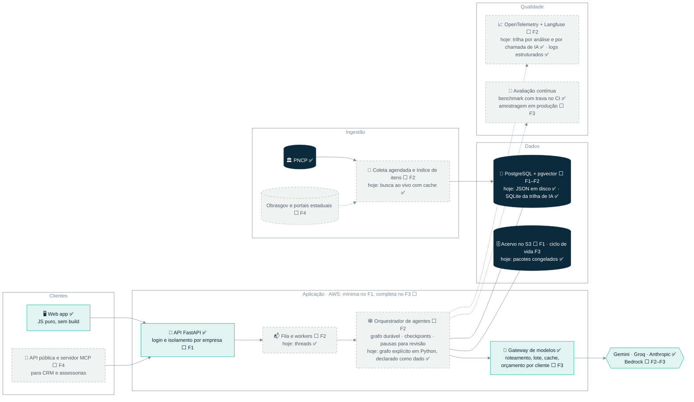
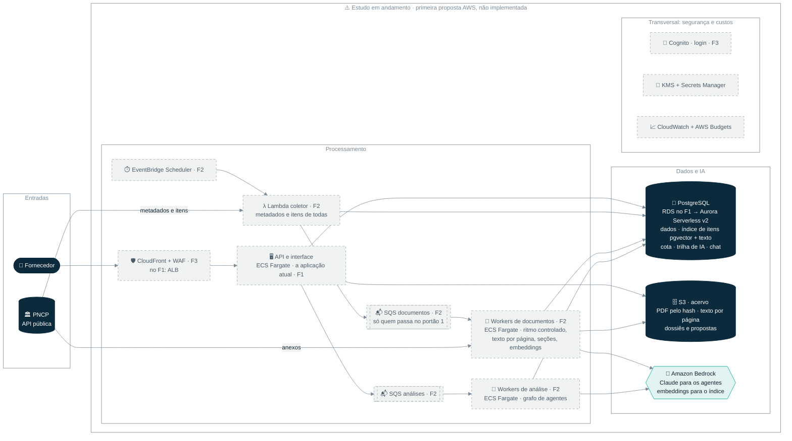

<p align="center">
  <picture>
    <source media="(prefers-color-scheme: dark)" srcset="images/logo-complete-dark.png">
    
  </picture>
</p>

<h3 align="center">Todo dia, o governo publica mais de mil pedidos de compra.<br>Quem entende primeiro, vende primeiro.</h3>

<p align="center">
  O ObraNexo é uma plataforma de agentes de IA que lê licitações do PNCP item por item, cruza cada exigência
  com o catálogo de um fornecedor e mostra o que ele atende, apontando a linha exata do edital.
  Começamos por material elétrico e iluminação, onde 9 em cada 10 pregões não citam esses itens no título: só quem lê os itens os encontra.
</p>

<p align="center">
  <a href="https://kauandivino.github.io/obranexo/"></a>
</p>

<p align="center">
  
  
  
  <a href="https://github.com/kauandivino/obranexo/actions/workflows/ci.yml"></a>
  
  
  
</p>

<p align="center">
  <a href="#em-30-segundos">Em 30 segundos</a> ·
  <a href="#o-problema-em-números">Problema</a> ·
  <a href="#como-funciona">Como funciona</a> ·
  <a href="#arquitetura-agêntica">Arquitetura agêntica</a> ·
  <a href="#validação-e-resultados">Resultados</a> ·
  <a href="#status-e-roadmap">Roadmap</a> ·
  <a href="#quickstart">Quickstart</a> ·
  <a href="#referência">Referência</a>
</p>

<p align="center">
  <picture>
    <source media="(prefers-color-scheme: dark)" srcset="docs/images/prova_dark.png">
    
  </picture>
  <br>
  <sub>Cada conclusão abre o trecho literal que a sustenta. Pregão real: Goianira/GO, PE 038/2026, luminárias LED.</sub>
</p>

<p align="center">▶ <a href="pitch/demo_obranexo_90s.mp4"><b>Demo em vídeo (90 s)</b></a> — catálogo, pregão real, veredito com prova, trilha dos agentes, dossiê e assistente · sem áudio, feita para rodar dentro do pitch</p>

---

## Sumário

1. [Em 30 segundos](#em-30-segundos) — o que é, para quem, o que já funciona
2. [O problema em números](#o-problema-em-números) — medição própria no PNCP
3. [Como funciona](#como-funciona) — do catálogo ao dossiê, com um exemplo real de entrada e saída
4. [Arquitetura agêntica](#arquitetura-agêntica)
   - [Os agentes](#os-agentes) — 7 agentes, ferramentas, limites e memória de cada um
   - [Núcleo verificável](#núcleo-verificável) — validação, citação conferida e motor de regras
   - [Orquestração, estado e memória](#orquestração-estado-e-memória) — grafo explícito e estado compartilhado
   - [Guardrails e revisão humana](#guardrails-e-revisão-humana)
   - [Observabilidade e avaliação](#observabilidade-e-avaliação) — trilha de chamadas, custo real, logs, benchmark, CI
   - [Como a busca encontra licitações](#como-a-busca-encontra-licitações) — encontrar candidatos × decidir
   - [Decisões de projeto](#decisões-de-projeto) — por que regras decidem e por que não há LangChain
   - [Uma prospecção real atravessando o sistema](#uma-prospecção-real-atravessando-o-sistema)
5. [Diferenciais](#diferenciais)
6. [Validação e resultados](#validação-e-resultados) — benchmark, teste cego, testes, custo medido
7. [Modelo de negócio e mercado](#modelo-de-negócio-e-mercado)
8. [Status e roadmap](#status-e-roadmap) — fases F0 a F4
   - [Arquitetura em nuvem (AWS) — estudo em andamento](#arquitetura-em-nuvem-aws--estudo-em-andamento)
9. [Quickstart](#quickstart) — instalação, comandos e [provedores de IA](#provedores-de-ia)
10. [Limitações conhecidas e próximos desafios](#limitações-conhecidas-e-próximos-desafios)
11. [Referência](#referência) — arquitetura da aplicação, endpoints da API, casos congelados, estrutura do repositório
12. [Documentação](#documentação) — fluxo do agente (inputs, lógica, outputs), plano de desenvolvimento, BMC, pitch
13. [Time e contato](#time-e-contato) · [Licença](#licença)

---

## Em 30 segundos

| | |
|---|---|
| **O que é** | Uma plataforma de inteligência comercial agêntica para contratações públicas. O fornecedor carrega o catálogo; os agentes buscam no PNCP, leem edital, termo de referência e anexos, e dizem, **item a item**, se cada produto atende, não atende, atende em parte ou se falta informação. Todo veredito vem com a prova. Quando o fornecedor decide disputar, o ObraNexo monta o kit da proposta que ele entrega ao órgão: cada item com o produto, a marca e o modelo ofertados, já conferidos contra as exigências do edital, os prazos com prova, os documentos técnicos e a **proposta de preços em Word**, pronta para precificar e assinar. Quem revisa, precifica e envia é sempre o fornecedor. A lista de habilitação e declarações do edital está *em construção*. |
| **Para quem** | Distribuidores e atacadistas de material elétrico e iluminação, em geral micro e pequenas empresas sem analista de licitação. Depois: varejo elétrico, fabricantes, assessorias de licitação e construtoras. |
| **Por que importa** | O PNCP publica cerca de **1.100 pregões eletrônicos por dia**. Cerca de **90% dos pregões com itens elétricos não dizem isso no objeto**, então escapam de qualquer alerta por palavra-chave. Quem lê tudo, acha a licitação certa e acerta a especificação disputa contra poucos; quem erra uma especificação é desclassificado. |
| **O que já funciona** | Prospecção autônoma no PNCP ao vivo, análise completa de 9 licitações reais congeladas, 7 agentes (a análise roda num grafo explícito, declarado como dado), assistente em linguagem natural, catálogo por ficha técnica do fabricante, dossiê com prova, kit da proposta com a proposta de preços em Word, 3 provedores de IA com reserva automática, trilha de cada chamada de IA com agente, modelo, tokens, custo e latência. Sem chave de API, a análise, o dossiê e o kit da proposta rodam em modo determinístico; prospecção, assistente e importação de fichas usam um provedor de IA. |

> **Princípio de projeto.** A IA decide o que buscar, o que abrir, o que ler e o que investigar. Um núcleo verificável — validação por tipo e faixa, motor de regras e citação conferida no documento — garante que o veredito final seja auditável. Sem prova, o sistema diz **indeterminado** em vez de inventar.

## O problema em números

Medição própria feita com o conector do ObraNexo sobre **64.473 pregões eletrônicos do PNCP** (junho e setembro–outubro de 2026). Método e limitações em [`BMC_ObraNexo.txt`](BMC_ObraNexo.txt).

| Número | O que significa |
|---|---|
| **~1.110 pregões eletrônicos por dia** | 33.406 em 30 dias (24/09 a 23/10/2026). Ninguém lê isso à mão. |
| **R$ 6,1–6,4 bilhões por ano** | valor estimado em itens de material elétrico, só em pregão eletrônico; iluminação é 83% disso |
| **~90% invisíveis por palavra-chave** | dos pregões com itens elétricos, só cerca de 10% citam material elétrico no objeto. O item está na lista, não no título. |
| **23 itens elétricos por pregão** (mediana 8) | cada um com potência, fluxo, IP, garantia, INMETRO… a conferir contra o catálogo |
| **45% dos itens elétricos exclusivos para ME/EPP** | um mercado reservado por lei que fica deserto quando faltam pequenas empresas qualificadas |
| **6–12% dos itens desertos ou fracassados** | demanda que ninguém viu, ou propostas recusadas por especificação |
| **8 dias úteis** | prazo mínimo entre a publicação e a proposta (Lei 14.133) |
| **R$ 110 a R$ 700 por edital** | custo interno de analisar um edital à mão, ganhando ou não (estimativa sobre salário médio de analista) |

## Como funciona



1. **Catálogo.** Planilha CSV/XLSX, JSON, ou o link/PDF da ficha técnica do fabricante: a IA propõe os produtos com atributos validados e o usuário revisa antes de adicionar.
2. **Prospecção.** O agente lê o catálogo, escolhe os termos de busca, consulta os pregões com propostas abertas no PNCP, examina itens e decide quais licitações merecem análise completa.
3. **Leitura.** Edital, termo de referência e anexos (PDF, DOCX, XLSX, ZIPs expandidos). Itens publicados só com o nome ("cabo elétrico flexível") ganham a especificação lida no TR.
4. **Veredito.** Cada exigência é comparada com cada atributo do produto. Quatro estados por item: **compatível**, **parcial**, **indeterminado**, **incompatível**. Nunca "atende" sem prova.
5. **Dossiê e decisão.** Classificação da oportunidade (publicada, planejada, indireta em obra), comprador provável, prioridade 0–100, riscos, próximos passos — e a decisão humana de seguir ou descartar.
6. **Proposta.** Para seguir, o kit da proposta: o que ofertar em cada item (produto incompatível nunca entra), marca, modelo e fabricante, descrição só com atributos confirmados, prazos e documentos técnicos — e a proposta de preços em Word, com os preços em branco e uma página de conferência interna (por exemplo: "o relé tem garantia de 2 anos; o edital pede 5").

<details>
<summary><b>Exemplo real de entrada e saída</b> — Goianira/GO, PE 038/2026, item 1 (modo determinístico, 2,8 s)</summary>

**Entrada** (descrição do item no PNCP, 1.125 unidades a R$ 311,50):

> LUMINÁRIA PÚBLICA LED 100 WTS, POTÊNCIA 100 WTS, COR 5000K LUZ BRANCA FRIA, TENSÃO DE OPERAÇÃO AUTOVOLT (100V-277) […] EFICIÊNCIA LUMINOSA 140LM/WATT, FLUXO LUMINOSO 14000 LM […] ÍNDICE DE PROTEÇÃO IP 66, VIDA ÚTIL 50,000 HORAS […] 05 ANOS DE GARANTIA […] OBRIGATÓRIO APRESENTAÇÃO DO TERMO DE GARANTIA, REGISTRO DE INMETRO, ENSAIOS E CURVA FOTOMÉTRICA IES.

**Saída**: 27 requisitos (25 da descrição, 2 encontrados pelo Investigador no edital: prazo de 10 dias e amostra). Três candidatos da categoria, cada requisito com o trecho que o originou:

| Produto | Veredito | Por quê |
|---|---|---|
| LPL-100-50K | ✅ **COMPATÍVEL** | 100 W, 5000 K, 145 lm/W ≥ 140, 14.500 lm ≥ 14.000, IP66, IK09 ≥ IK08, 60.000 h, 5 anos, INMETRO, dimerizável, tomada para relé |
| LPL-100-50K-PRO | ⚪ **INDETERMINADO** | tecnicamente superior (175 lm/W, IK10), mas o catálogo **não informa a garantia** exigida de 5 anos |
| LPL-150-50K-PRO | 🔴 **INCOMPATÍVEL** | 150 W quando o edital pede 100 W; fator de potência 0,96 < 0,98 |

107 evidências na análise, **107 conferidas literalmente** no documento de origem. Dossiê completo em [`docs/exemplo_dossie_goianira.md`](docs/exemplo_dossie_goianira.md).
</details>

<p align="center">
  <picture>
    <source media="(prefers-color-scheme: dark)" srcset="docs/images/itens_dark.png">
    
  </picture>
</p>

## Arquitetura agêntica

**Legenda de status**, usada em todo este documento: ✅ roda hoje · 🟡 parcial · ⬜ planejado (F1–F4, ver [roadmap](#status-e-roadmap)).

O ObraNexo é **IA-first**: os agentes conduzem o trabalho de fronteira — o que buscar, o que abrir, o que ler, onde investigar, como ranquear. O que os torna confiáveis é o **núcleo verificável** por onde toda proposta de um modelo precisa passar antes de virar fato. Esse núcleo não é uma limitação da IA; é o que permite deixá-la agir com autonomia.



### Os agentes

Três agentes conduzem loops de ferramentas (decidem a ordem e a profundidade do trabalho); os demais são especialistas chamados pelo pipeline com saída estruturada validada por esquema.

| Agente | Papel | Ferramentas | Limites e memória | Status |
|---|---|---|---|---|
| 🧭 **Prospector** | Lê o catálogo, escolhe os termos, busca pregões abertos no PNCP, examina itens, decide quais analisar a fundo e entrega um ranking justificado | `buscar_licitacoes_abertas` · `ver_itens` · `analisar_a_fundo` · `concluir` | 16 passos; até 5 análises completas; ids inventados são descartados; ranking que contradiz a análise volta com os fatos | ✅ |
| 🕵️ **Investigador** | Procura nos anexos a especificação que falta e as exigências gerais do edital (garantia, prazo, amostra, INMETRO, ensaios) | `listar_documentos` · `buscar_trechos` · `ler_pagina` · `registrar_requisito` · `concluir_investigacao` | 12 passos (+2 por item sem spec, máx. 24); orçamento próprio de tokens; **citação conferida no ato do registro**: trecho inexistente volta como erro para o agente corrigir | ✅ |
| 💬 **Assistente** | Conversa em linguagem natural com dados ao vivo: busca licitações, consulta o catálogo e as análises salvas, dispara análises | `buscar_licitacoes_abertas` · `ver_itens` · `consultar_catalogo` · `analises_salvas` · `detalhar_analise` · `analisar_a_fundo` | 8 chamadas de ferramenta por mensagem; histórico por sessão | ✅ |
| 📑 **Analista Técnico** | Extrai requisitos canônicos dos itens, em lotes de até 10, cada um com o trecho literal | saída estruturada (Pydantic) | regras pt-BR sempre rodam; o que só a IA achou entra como desejável | ✅ |
| 🔍 **Especificador** | Localiza as páginas do TR que tratam dos itens publicados só com o nome e lê todas de uma vez; roda no modelo de agente, porque decidir a qual item pertence um trecho é julgamento | saída estruturada | trecho precisa existir no documento e no bloco daquele item; atributo de luminária não entra em relé, cabo ou disjuntor | ✅ |
| 🛡️ **Verificador** | Reconfere todas as citações, detecta conflitos entre fontes, atribui confiança e escreve o parecer para revisão humana | regras + parecer em texto | confiança baixa → fila de revisão | ✅ |
| 🧠 **Planejador** | Resumo executivo, riscos e próximos passos, só a partir dos fatos já verificados | saída estruturada | qualificação (tipo, comprador, prazo, prioridade) vem de regras | ✅ |
| 🗂️ **Curador de catálogo** | Lê a ficha do fabricante (link, PDF, DOCX, XLSX, texto) e propõe produtos com atributos validados; vai apontar as lacunas do catálogo que geram INDETERMINADO e sugerir fichas | saída estruturada | usuário revisa antes de adicionar | 🟡 |
| 📡 **Monitor** | Ingestão contínua por UF e categoria, retificações de edital, alertas de novas oportunidades aderentes | coleta agendada · índice de itens | — | ⬜ F2 |
| 📜 **Habilitação** | Checklist documental do edital (certidões, atestados, amostra, prazos) cruzado com o que a empresa tem; alimenta a lista de habilitação do kit da proposta | leitura do edital · memória da empresa | — | ⬜ F1–F2 |
| 🏗️ **Rastreador de obras** | Em oportunidades indiretas, identifica a construtora vencedora na ata e no contrato e sugere o contato | PNCP (atas, contratos) | — | ⬜ F3 |
| 💰 **Precificação** | Histórico de preços homologados por item e órgão para apoiar a proposta — **nunca dá lance** | PNCP (resultados) · índice de itens | — | ⬜ F4 |

### Núcleo verificável

Toda proposta de um modelo passa por três portas antes de virar fato. É isso que permite dar autonomia aos agentes.

| Porta | O que faz | Exemplos reais, do teste cego |
|---|---|---|
| **Validação por tipo, faixa e categoria** (`rules/validar.py`, `catalog/atributos.py`) | cada valor proposto é checado contra o tipo e a faixa plausível do atributo; atributos luminotécnicos (fluxo, dimerização, CCT…) só entram em itens que emitem luz | rejeitados: `cct_k = "branca fria"`, `tensao_v = 600–1000` (era isolação de cabo), `material_corpo = "PRETA"`, `irc = 0,7`; em 24/10, "dimerizável" lido no TR da luminária e atribuído ao relé |
| **Citação conferida** (`evidence/verify.py`) | o trecho literal precisa existir na página citada (similaridade ≥ 90); conferido no registro e de novo pelo Verificador | 107/107 em Goianira, 72/72 em Itaberaí, 62/62 em Aruanã |
| **Motor de regras** (`rules/compare.py`) | compara cada requisito com cada atributo: número com tolerância, faixa que precisa cobrir, IP/IK ordinais, booleanos, texto, exigências documentais | IP65 < IP66 → não atende; garantia ausente no catálogo → indeterminado, nunca "atende" |

Agregação por item: qualquer obrigatório não atendido → **INCOMPATÍVEL**; obrigatório sem informação → **INDETERMINADO**; só desejáveis falhando → **PARCIAL**; todos os obrigatórios atendidos → **COMPATÍVEL**.

### Orquestração, estado e memória

| Dimensão | Hoje ✅ | Produção |
|---|---|---|
| Orquestração | **grafo explícito declarado como dado** (`agents/grafo.py`; `GRAFO` em `agents/pipeline.py`): 13 nós, cada um com nome, agente, modelo (agente/extração), condição em palavras e em código e os campos do estado que lê e escreve; é o mesmo objeto que executa a análise nó a nó, alimenta `GET /api/conteudo/grafo` e a tela "Como funciona"; nó condicional que não se aplica é pulado com um evento na trilha; jobs em threads com eventos SSE | grafo durável com checkpoints no Postgres (LangGraph é a opção): retomar após falha, pausar para revisão humana, reexecutar um nó ⬜ F2 |
| Estado da análise | JSON por análise: itens, requisitos, correspondências, evidências, conflitos, lacunas, trilha de eventos, versão dos prompts; durante a execução, o `Contexto` (`agents/contexto.py`) é o único estado compartilhado entre os nós, com os campos de trabalho documentados (`documentos_entrada`, `relevantes`, `afetados`, `plano`); trilha de chamadas de IA em SQLite (`data/obranexo.db`) | Postgres com isolamento por empresa (RLS) ⬜ F1–F2 |
| Memória da empresa | catálogo persistido; UFs atendidas e raio logístico; conversas do assistente persistidas em SQLite (sobrevivem ao reinício do servidor) | decisões "seguir/descartar" que recalibram a prioridade; documentos de habilitação; histórico de propostas ⬜ F2 |
| Memória de mercado | pacotes congelados de licitações; cache do PNCP | índice de itens com busca híbrida (texto + vetorial, pgvector); histórico de preços ⬜ F2–F4 |
| Ferramentas | definidas por agente, com esquema `strict` | registro único no padrão MCP, com permissões por agente ⬜ F2 |
| Modelos | Gemini, Groq e Anthropic pela mesma interface; temperatura 0 em todos; reserva automática em 429/503/timeout; quarentena de 10 min; cache em disco por entrada; custo pela tabela oficial de preços (`config.py`), com raciocínio cobrado como saída | gateway com roteamento por tarefa (extração em lote no modelo barato, raciocínio no forte), Batch API, orçamento por cliente ⬜ F3 |

### Guardrails e revisão humana

- Documentos e descrições entram **como dados** (`<documento>`, `<item>`), nunca como instruções.
- **Nenhum agente tem ferramenta de ação externa**: não envia proposta, não dá lance, não participa de licitação.
- Saída de modelo sempre validada por esquema (Pydantic, `strict: true`); valor fora do tipo, da faixa ou da categoria do item é descartado com registro.
- Limites de passos, de tokens e de análises por prospecção; orçamento proporcional ao número de itens.
- Requisito tirado **só** pela IA da descrição entra como desejável: pode deixar o item parcial, nunca o derruba sozinho. Especificação do TR com citação conferida é exigência de verdade.
- **Pontos de revisão humana:** revisão dos produtos propostos pela ficha técnica ✅ · aprovar/rejeitar/comentar o dossiê ✅ · fila de confiança baixa 🟡 · pausa no grafo antes de análises caras e feedback que recalibra a prioridade ⬜ F2.

### Observabilidade e avaliação

- **Hoje ✅:** trilha completa de cada análise (nó, mensagem, modelo, item, documento), visível na interface e via SSE. **Trilha por chamada de IA** em SQLite (`observability/trilha.py`, tabela `chamadas_llm` em `data/obranexo.db`): toda chamada lógica a um provedor vira uma linha com agente, origem (análise, prospecção, chat, importação), versão do prompt, operação, provedor, modelo pedido × modelo usado, tokens de entrada, saída, raciocínio e cache, custo em US$, latência, cache, reserva, status/erro e resumo da entrada e da saída; o agente é identificado por escopo (`escopo(agente=...)`, um contextvar), inclusive nos lotes em paralelo do Analista Técnico; exposta em `GET /api/analises/{id}/chamadas` e `GET /api/metricas/llm` e na interface (aba **Trilha do agente → Chamadas de IA**; tela **Qualidade → Uso de modelos**). **Logs estruturados** com a biblioteca padrão (`observability/logs.py`): uma linha por etapa e por chamada de modelo; JSON por linha com `OBRANEXO_LOG_JSON=1`. **Custo real** pela tabela oficial de preços consultada em 24/10/2026 (`PRECOS_USD` em `config.py`), com os tokens de raciocínio lidos da resposta de cada API e cobrados como saída; por análise e por período em `GET /api/custos` (métrica interna, em US$ e R$, contra a meta de R$ 1 por análise); no nível gratuito a cobrança real é zero. Temperatura 0 em todos os provedores; versão dos prompts registrada na análise e em cada chamada. Nada disso derruba uma análise se falhar. Benchmark contra gabaritos revisados (`eval/run_benchmark.py`); testes de regressão gerados a partir de cada defeito encontrado em dados reais; **CI em todo PR** (lint, testes e o benchmark como trava: se uma métrica cair abaixo do mínimo em `eval/limiares.json`, o PR fica vermelho).
- **Produção ⬜:** OpenTelemetry + Langfuse por agente e por cliente; conjunto rotulado por duas pessoas com concordância medida (F1); amostragem revisada em produção e monitor de deriva da qualidade (F3).

<p align="center">
  <picture>
    <source media="(prefers-color-scheme: dark)" srcset="docs/images/chamadas_ia_dark.jpg">
    
  </picture>
  <br>
  <sub>Trilha de chamadas de IA da análise de Itaberaí/GO com o Gemini: 17 chamadas, US$ 0,145, cada uma com agente, modelo, tokens (entrada / saída / raciocínio), custo e latência.</sub>
</p>

### Como a busca encontra licitações

Encontrar e decidir são etapas diferentes, e só a primeira usa (ou vai usar) busca por significado:

| Etapa | Hoje | Com o índice de itens (⬜ F2) |
|---|---|---|
| **1. Quem entra na fila** | palavra no **objeto** da licitação, com os termos escolhidos pelo agente a partir do catálogo; o agente então abre os itens das candidatas. Ainda não alcança os ~90% que não citam o segmento no objeto | **busca híbrida sobre os itens**: palavra exata (IP66, 100 W, NBR) e significado ("luminária viária" ≈ "luminária pública") — a mesma leitura de itens com que medimos os 90%, agora contínua |
| **2. Qual a categoria do item** | regras sobre o começo da descrição; a IA sugere quando as regras não reconhecem | igual; o significado também ajuda quando a redação foge do comum |
| **3. Atende ou não atende** | **motor de regras**, por atributo, com prova literal — não é comparação de texto exato | **igual, sem mudança** |

A busca por significado só decide **quem entra na fila e em que ordem**: nunca descarta sozinha e nunca decide compatibilidade. A IA encontra e interpreta; as regras decidem; tudo tem prova.

### Decisões de projeto

| Decisão | Por quê |
|---|---|
| **Agentes, e não um pipeline fixo, para prospecção e investigação** | São tarefas de busca em aberto: os termos certos dependem do catálogo, a licitação certa depende dos itens, e a especificação que falta pode estar em qualquer anexo. Palavra-chave fixa no objeto enxerga só ~10% dos pregões com itens elétricos (medição própria): por isso o agente escolhe os termos, abre os itens e decide o que ler; o índice de itens (F2) leva essa leitura para a descoberta. |
| **Regras decidem a compatibilidade, a IA interpreta** | "IP65 atende IP66?" tem resposta certa e precisa ser a mesma sempre. O veredito determinístico é auditável, testável e explicável linha a linha. No teste cego, um valor inventado pelo modelo derrubava a análise inteira; hoje é descartado e registrado. |
| **Citação conferida no ato do registro** | Verificar só no fim deixa o agente seguir por um caminho errado. Devolver o erro na hora faz o agente corrigir a si mesmo e barra alucinação de trecho na origem. |
| **Três provedores pela mesma interface** | Nível gratuito instável (429/503) não pode derrubar uma demo nem um cliente. Troca de modelo é configuração, não reescrita. |
| **Orquestração própria, sem LangChain/LangGraph** | O edital avalia a qualidade da aplicação, não a ferramenta. A orquestração é explícita: o grafo é declarado como dado (`agents/grafo.py`), cada nó diz o que lê, o que escreve e quando roda, é testado (`tests/test_grafo.py`) e observável (cada chamada de IA fica ligada ao agente e à análise na trilha). LangGraph continua como opção de F2 para checkpoints duráveis e pausas para revisão. |
| **Busca por significado só para encontrar candidatos** | Hoje a descoberta depende de palavra no objeto e o cruzamento é por categoria + atributos. O índice de itens (F2) será híbrido — palavra exata e significado — e decide só quem entra na fila e em que ordem; o veredito continua no motor de regras. Primeiro provamos o veredito com prova; depois atacamos os 90% invisíveis. |
| **Modo determinístico sem chave de API** | A demo e os testes nunca dependem de cota de terceiros; o núcleo verificável roda sozinho. |

### Uma prospecção real atravessando o sistema



Os números do diagrama são de uma execução real em 24/10/2026: 9 páginas e cerca de 450 pregões com propostas abertas em GO; 18 candidatos pelos termos de iluminação e material elétrico; Anápolis com 206 itens. Fontes dos diagramas em [`docs/diagrams/`](docs/diagrams/).

<p align="center">
  <picture>
    <source media="(prefers-color-scheme: dark)" srcset="docs/images/trilha_dark.png">
    
  </picture>
  <br>
  <sub>Trilha do agente: cada passo da análise fica registrado e visível.</sub>
</p>

## Diferenciais

O que é difícil de copiar não é "ler edital com IA" — isso virou padrão de mercado. É a combinação:

1. **Veredito por atributo contra o catálogo, com quatro estados.** Não "este edital parece relevante", mas "o LPL-100-50K atende os 25 requisitos do item 1; o PRO fica indeterminado porque falta a garantia na ficha".
2. **Prova literal em cada conclusão, conferida duas vezes.** Trecho, documento e página. Quem revisa clica e vê.
3. **Indeterminado explícito.** O sistema diz o que não sabe e onde procurou. É o estado que gera confiança e, no produto, puxa o cliente a completar o catálogo.
4. **Leitura item a item, onde a demanda se esconde.** Cerca de 90% dos pregões com itens elétricos não dizem isso no objeto: só aparecem para quem lê os itens. Foi assim, lendo os itens com o próprio conector e as regras de categoria do ObraNexo, que medimos esse número. Dentro de cada licitação o ObraNexo já lê item a item; levar essa leitura para a descoberta contínua, com o índice de itens, é o próximo passo (⬜ F2).
5. **Demanda indireta em obras.** Concorrência de obra pública não lista luminárias nos itens; o sistema varre projetos e memoriais e aponta a construtora como comprador provável.
6. **Vertical em material elétrico e iluminação.** Taxonomia de 32 atributos (potência, fluxo, eficiência, CCT, IRC, IP, IK, DPS, seção, tipo de cabo…) com regras de comparação específicas. O motor é genérico; a taxonomia é o ativo.
7. **Autonomia com freios auditáveis.** Agentes decidem; validação, citação e regras garantem; a pessoa aprova.

## Validação e resultados

Só dados reais. Tudo abaixo é reproduzível a partir deste repositório; as linhas que não citam um provedor rodam em modo determinístico, sem chave de API.

| O quê | Resultado | Como conferir |
|---|---|---|
| Testes automatizados | **157 passando** (unitários + API, incluindo observabilidade, grafo, custos, paginação do PNCP, kit da proposta e o retrato da demo), lint limpo (ruff); rodam em todo PR no CI, em Linux | `pytest -m "not integracao"` · [Actions](https://github.com/kauandivino/obranexo/actions/workflows/ci.yml) |
| Custo e latência medidos (24/10, Gemini) | Itaberaí, 21 itens, sem cache: 17 chamadas, 0 erros, 165 mil tokens (4,8 mil de raciocínio), **US$ 0,145 ≈ R$ 0,73** pela tabela paga, 78 s, latência média 4,9 s e p95 9,9 s por chamada, 73/73 evidências; o Investigador respondeu por 68% do custo | trilha em `data/obranexo.db` · `GET /api/analises/{id}/chamadas` · `GET /api/custos` · tela **Qualidade → Uso de modelos** |
| Benchmark contra gabaritos revisados | 2 contratações, 9 itens e 8 pares item × produto: **100% de acerto por item, 100% nos pares, 100% de rastreabilidade** | `python eval/run_benchmark.py` · [`docs/benchmark_resultado.json`](docs/benchmark_resultado.json) |
| Tempo | 5 s para os 2 casos em modo determinístico; 55 s com Gemini (2 chamadas) | idem |
| Teste cego | **5 pregões abertos nunca vistos**, 133 itens, rodados sem ajuste prévio; 10 defeitos encontrados e corrigidos, cada um virou teste de regressão; rastreabilidade 100% nas duas rodadas | [`docs/teste_cego_2026-10-23.md`](docs/teste_cego_2026-10-23.md) · `tests/test_regressao_teste_cego.py` |
| Busca ao vivo no PNCP | 24/10/2026: 9 páginas, ~450 pregões abertos em GO em 44 s; 18 candidatos pelos termos de iluminação; detalhe de uma licitação com 206 itens em 1,4 s | `obranexo abertas --uf GO` |
| Casos reais congelados | 9 contratações do PNCP (R$ 1,4 mi a R$ 32 mi), 343 itens, 170 anexos | `obranexo casos` |

**Limites honestos desses números.** O benchmark de 100% é **dentro da amostra**: os 2 casos rotulados foram usados no desenvolvimento e o gabarito é da própria equipe. Os 5 casos do teste cego estão rotulados pelo sistema, com **gabarito humano pendente** em [`docs/teste_cego_rotulagem.csv`](docs/teste_cego_rotulagem.csv) — não foram rotulados pela mesma pessoa que corrigiu o código, para o benchmark não virar circular. O custo em US$ é **estimado pela tabela oficial de preços** a partir dos tokens que cada API devolve (raciocínio incluído), por chamada na trilha e por análise em `GET /api/custos` (métrica interna); no nível gratuito do Gemini e do Groq a cobrança real é zero. A única análise medida até agora é a de Itaberaí: **R$ 0,73**, acima da faixa estimada na pesquisa (R$ 0,02 a R$ 0,48, calculada para modelos baratos) porque usou o modelo mais forte em todos os agentes, e ainda dentro da meta de R$ 1 por análise. O Investigador respondeu por 68% desse custo: é ali que o roteamento por tarefa (F3) atua para trazer o custo para a faixa.

**Metodologia planejada (F1–F2).** Gabarito duplo (duas pessoas, divergências resolvidas, concordância medida) para 10 ou mais contratações e 150 a 300 pares; métricas-alvo do roadmap: precisão de COMPATÍVEL ≥ 85%, recall de itens relevantes ≥ 80%, detecção de incompatibilidade obrigatória ≥ 90%, rastreabilidade ≥ 95%, consistência entre execuções ≥ 90%, tempo ≤ 3 min; cronometragem do trabalho manual contra o assistido com 5 a 10 empresas no piloto.

## Modelo de negócio e mercado

Resumo do [Business Model Canvas](https://kauandivino.github.io/obranexo/) (versão interativa; texto completo com fontes em [`BMC_ObraNexo.txt`](BMC_ObraNexo.txt)) e do [relatório de modelo de negócio](reports/Modelo%20de%20negócio%20ObraNexo.md). Natureza de cada número: **[FATO]** publicado com fonte · **[DADO PRÓPRIO]** medido pela equipe no PNCP · **[ESTIMATIVA]** cálculo da equipe · **[PREMISSA]** hipótese a validar.

| | |
|---|---|
| **Mercado** | R$ 1 trilhão em compras no PNCP em 2025 [FATO, MGI] → R$ 6,1–6,4 bi/ano em itens elétricos [DADO PRÓPRIO] → 7–13 mil empresas-alvo e R$ 51–96 mi/ano de mercado de software [ESTIMATIVA] → cenário-base de 250 clientes e R$ 1,8 mi de ARR em 36 meses [PREMISSA] |
| **Cliente núcleo** | distribuidores e atacadistas de material elétrico (CNAE 4673-7/00): 3,4–4,2 mil empresas, em geral ME/EPP [FATO]; persona: sócio-gerente ou vendedor técnico que acumula a licitação |
| **Planos** [PREMISSA] | Radar grátis (1 UF, 3 análises/mês) · Essencial R$ 397/mês · Profissional R$ 897/mês (todas as UFs, obras, 3 usuários) · Assessoria R$ 1.490–2.490/mês (5–10 CNPJs) · Fabricante/Enterprise sob consulta · créditos avulsos R$ 39/análise. Âncoras: concorrentes cobram R$ 101–1.397/mês [FATO] |
| **Economia unitária** | IA custa centavos por análise: R$ 0,02–0,48 com modelos baratos [ESTIMATIVA sobre preços oficiais]; primeira medição real, com o modelo forte em todos os agentes, R$ 0,73, dentro da meta de R$ 1 [DADO INTERNO]; margem bruta-alvo 75–85%; custo interno evitado pelo cliente de R$ 110–700 por edital [ESTIMATIVA] |
| **Canais** | assessorias de licitação (multi-CNPJ, canal de revenda), radar gratuito que converte, fabricantes que querem a rede de revenda vendendo ao governo, Sebrae e feiras |
| **Impacto** | cada licitante qualificado a mais reduz o preço em ~3,4% [FATO, estudo europeu]; ganhar um contrato acelera o crescimento da empresa em 2,2 p.p. [FATO, NBER]; iluminação pública com ~80% dos 22 milhões de pontos sem LED [FATO]. ODS 7, 8, 9, 11, 12.7, 16 |
| **Validação com clientes** | [DADO NECESSÁRIO] entrevistas com fornecedores · [DADO NECESSÁRIO] disposição a pagar · [DADO NECESSÁRIO] piloto supervisionado — planejados para F1–F2 |

**Pedido do pitch:** piloto de 60 dias com 10 distribuidores de Goiás e apoio AKCIT/Embrapii para levar o MVP a produção.

## Status e roadmap

A visão é ampla; a execução começa pequena, verificável e orientada por resultados. Cada fase só avança quando o critério de saída é atingido.

| Fase | Período | Objetivo | Entregas principais | Critério de saída |
|---|---|---|---|---|
| **F0 · v0.1** Prova de conceito | 22–24/10/2026 | demo de ponta a ponta com dados reais | 7 agentes, PNCP ao vivo, 9 casos reais, catálogo por ficha, assistente, 3 provedores, benchmark, teste cego, grafo explícito, trilha de chamadas de IA em SQLite com custo real e logs estruturados, CI com benchmark como trava, kit da proposta e proposta de preços em Word | os 7 critérios da demo rodam offline sem intervenção — **atingido ✅** |
| **F1 · v0.2** MVP robusto | 25/10–28/11/2026 | confiabilidade e primeira prova de valor | gabarito duplo em 10+ contratações; PostgreSQL + Alembic; login e isolamento por empresa; Docker; CI com benchmark como trava ✅; busca em todas as modalidades; recalibração da prioridade; 5 entrevistas e 1–2 pilotos | roda na nuvem (AWS) com Postgres; benchmark ≥ 10 contratações; ≥ 1 piloto com fornecedor real |
| **F2 · v0.3** Beta fechado | dez/2026–fev/2027 | plataforma agêntica e piloto em escala | grafo durável com checkpoints e pausas para revisão; registro MCP de ferramentas; Monitor (ingestão contínua, índice híbrido com pgvector, alertas); Habilitação; feedback que recalibra; fila com workers; OTel + Langfuse; PCA, OCR e tabelas; **piloto de 60 dias com 10 distribuidores** | precisão ≥ 95% fora da amostra; rastreabilidade 100%; custo medido < R$ 1/análise; 95% das análises em < 3 min |
| **F3 · v1.0** Produção | mar–jun/2027 | operar com clientes pagantes | AWS como código (ECS Fargate, Aurora/RDS PostgreSQL + pgvector, S3, SQS, Bedrock, Cognito — [estudo em andamento](#arquitetura-em-nuvem-aws--estudo-em-andamento)); gateway de modelos com roteamento, lote e orçamento por cliente; RLS e anexos versionados; Rastreador de obras; planos e cobrança; LGPD documentada, pentest, trilha de auditoria; avaliação contínua em produção | 30 dias cumprindo as metas de serviço (99,5%, p95 < 90 s); margem 75–85% |
| **F4 · v1.x** Escala | 2º sem/2027 → | novas fontes, segmentos e agentes | Obrasgov e portais estaduais; Precificação com histórico de preços; grafo órgão–objeto–item–fornecedor; API pública e servidor MCP para CRM e assessorias; novos segmentos (hidráulica, climatização, incêndio) | churn < 3%/mês; LTV/CAC ≥ 3 |

**Arquitetura-alvo da aplicação**: o que roda hoje (✅) e o que entra (⬜). Onde ela roda na AWS está no [estudo logo abaixo](#arquitetura-em-nuvem-aws--estudo-em-andamento).



### Arquitetura em nuvem (AWS) — estudo em andamento

> **Estudo em andamento.** Primeira proposta de arquitetura na AWS, **ainda não implementada nem validada em custo**. Serviços, região e preços serão confirmados antes de qualquer decisão. Detalhes, decisões pendentes e a comparação com uma proposta externa em [`docs/PLANO_DESENVOLVIMENTO.md`](docs/PLANO_DESENVOLVIMENTO.md#arquitetura-em-nuvem-aws--estudo-em-andamento).



- **Guardar seguindo o funil, não "tudo":** metadados e itens de todas as licitações; PDFs e texto por página só das que têm item do portfólio; análise completa só das escolhidas. O disco é barato (~4 MB de anexos por pregão, medido); o que limita é o ritmo aceito pelo PNCP, o processamento dos PDFs e os tokens.
- **Um PostgreSQL para tudo que é estruturado e para o índice de itens** (pgvector + busca por texto); **S3** como acervo, com o texto por página sempre acessível para as provas e arquivo profundo só depois que a ata de registro de preços vencer.
- **Fases:** F1 — a aplicação atual em ECS Fargate, RDS PostgreSQL, S3, Secrets Manager e alerta de orçamento · F2 — coleta agendada (EventBridge + Lambda), filas (SQS), workers e índice de itens · F3 — Aurora Serverless v2, Cognito, KMS, CloudFront e WAF, Bedrock com lote noturno, AWS Budgets Actions.
- **Fora por enquanto:** DynamoDB, OpenSearch Serverless, AgentCore Memory, Bedrock Knowledge Bases e EKS. S3 Vectors fica como opção futura para busca semântica entre editais em grande volume.

O plano de desenvolvimento detalhado, com cada item ligado ao status acima, está em [`docs/PLANO_DESENVOLVIMENTO.md`](docs/PLANO_DESENVOLVIMENTO.md); o roadmap original do MVP, em [`ROADMAP_MVP.txt`](ROADMAP_MVP.txt).

## Quickstart

Testado em Windows 11 e macOS com Python 3.12. Sem chave de API, a análise, o dossiê e o kit da proposta rodam em **modo determinístico** (sem agentes de linguagem); com uma chave, entram os agentes, a prospecção, o assistente e a importação de fichas.

```powershell
# Windows (PowerShell)
python -m venv .venv
.\.venv\Scripts\Activate.ps1
pip install -e ".[dev]"
copy .env.example .env     # opcional: preencha GEMINI_API_KEY e/ou GROQ_API_KEY (ou ANTHROPIC_API_KEY)

obranexo servidor          # API + interface em http://127.0.0.1:8000 · documentação em /api/docs
```

```bash
# macOS / Linux
python3 -m venv .venv && source .venv/bin/activate
pip install -e ".[dev]"
cp .env.example .env       # opcional: idem

obranexo servidor
```

Na interface: **Licitações → Goianira → Analisar** mostra a análise ao vivo com a trilha dos agentes; na análise, clique numa prova. Com chave de IA, **Prospecção → Buscar oportunidades** roda o agente contra o PNCP ao vivo.

```powershell
obranexo casos                            # as 9 licitações reais congeladas
obranexo analisar goianira_pe038_2026     # análise completa pela linha de comando (2,8 s sem IA)
obranexo abertas --uf GO                  # pregões com propostas abertas, ao vivo no PNCP
obranexo coletar 01291707000167 2026 75 meu_caso   # baixa e congela uma contratação

pytest -m "not integracao"                # 157 testes, sem chamar o LLM (inclui o retrato da demo)
pytest -m integracao -v                   # chama o provedor configurado (usa cota)
python eval/run_benchmark.py              # benchmark contra os gabaritos
python eval/run_benchmark.py --limiares eval/limiares.json   # a mesma trava de qualidade do CI
obranexo grafo --formato md               # o grafo da análise (etapas, lê/escreve, condições), gerado do código
```

### Provedores de IA

| Provedor | Chave no `.env` | Modelos padrão | Observação |
|---|---|---|---|
| **Google Gemini** (padrão) | `GEMINI_API_KEY` | agentes `gemini-3.8-flash` (Especificador, Investigador, Verificador, Planejador, Prospecção, Assistente) → reserva `gemini-3.5-flash-lite`; extração `gemini-3.5-flash-lite` (Analista Técnico, Curador) | nível gratuito; o cliente cai para o reserva em 429/503 e põe o modelo em quarentena por 10 min |
| **Groq** | `GROQ_API_KEY` | agentes `openai/gpt-oss-120b`; extração `openai/gpt-oss-20b`; reserva `openai/gpt-oss-20b` (o Llama 3.3 70B saiu do nível gratuito do Groq em 16/08/2026) | saída estruturada por `json_schema` quando o modelo suporta; lotes menores por causa do limite de tokens por minuto |
| **Anthropic** | `ANTHROPIC_API_KEY` | `claude-sonnet-5-5` / `claude-haiku-5-5` | `OBRANEXO_LLM_PROVIDER=anthropic` |

Com mais de uma chave, o provedor é escolhido no seletor **IA** da barra superior (ou por `POST /api/config/llm`); a troca faz uma chamada mínima de teste. Texto, saída estruturada validada por Pydantic e chamada de ferramentas têm a mesma interface em todos os provedores (`src/obranexo/llm/client.py`), com temperatura 0. O custo de cada chamada é estimado pela tabela oficial de preços em `PRECOS_USD` (`config.py`, US$ por 1M tokens de entrada, saída e leitura de cache, consultada em 24/10/2026): `gemini-3.8-flash` 0,75/3,75/0,075 (preço introdutório até 31/12/2026) · `gemini-3.5-flash-lite` 0,30/2,50/0,03 · `openai/gpt-oss-120b` 0,15/0,60/0,075 · `openai/gpt-oss-20b` 0,075/0,30/0,037 · `claude-sonnet-5-5` 2/10/0,10 · `claude-haiku-5-5` 0,10/0,50/0,01 · `claude-opus-5-5` 4/20/0,20. Os tokens de raciocínio são lidos da resposta de cada API (`thoughts_token_count` no Gemini, `reasoning_tokens` no Groq, `thinking_tokens` na Anthropic) e cobrados como saída.

## Limitações conhecidas e próximos desafios

Encontradas em auditoria do código em 24/10/2026; todas têm item no plano de desenvolvimento. As resolvidas no mesmo dia (temperatura 0 em todos os provedores, custo real dos modelos, caminhos do Windows nos pacotes congelados que deixavam o edital "sem texto extraível" no macOS/Linux) saíram da lista.

| Limitação | Efeito | Correção |
|---|---|---|
| Busca só em pregão eletrônico (modalidade 6) | concorrências (obras), pregões presenciais e dispensas não entram na prospecção | parâmetro de modalidades · F1 |
| Tela de busca lê até 6 páginas; GO tinha 9 | cerca de um terço dos pregões abertos não aparece na interface (o Prospector lê 12) | limite dinâmico · F1 |
| Descoberta pela palavra no objeto, por substring | licitações com itens elétricos sob objeto genérico ("material de consumo") não aparecem; e há ruído: "faróis em **LED**" num SUV, "controle de **lumin**osidade" em persianas | índice de itens com busca híbrida · F2 |
| Um catálogo ativo por servidor | dois fornecedores na mesma instalação veriam o catálogo um do outro | login e isolamento por empresa · F1 |
| Categoria do produto precisa ser a chave exata (`luminaria_publica_led`) | planilha com "Luminária pública" não casa com nada, sem aviso | validação e sugestão na importação · F1 |
| Pesos da prioridade não calibrados | licitação encerrada (SRP) pode ficar acima de uma aberta | prazo aberto pesa mais; feedback recalibra · F1–F2 |
| Benchmark só com 2 casos internos | precisão fora da amostra ainda desconhecida | gabarito duplo dos 5 casos cegos + 3 novos · F1 |
| Custo de IA é estimativa a preço de tabela, com uma única análise medida (Itaberaí, R$ 0,73) | no nível gratuito do Gemini e do Groq a cobrança real é zero; a meta de R$ 1 por análise só se valida com volume e chave paga | acompanhar em `GET /api/custos` e na tela Qualidade; medir no piloto · F1–F2 |
| 32 atributos, quase todos de iluminação | número de condutores, comprimento de braço, classe de encordoamento ficam de fora | taxonomia por categoria · F2 |
| Sem OCR, sem PCA, sem tabelas de PDF | editais digitalizados e demanda planejada não são lidos | F2 |
| Persistência em JSON; o SQLite guarda a trilha de chamadas de IA e as mensagens do chat; jobs em memória | análises, prospecções e catálogo continuam em JSON; um job em andamento se perde ao reiniciar; não escala horizontalmente | Postgres (análises, trilha e chat no mesmo banco), fila e workers · F1–F2 |

## Referência

<details>
<summary><b>Arquitetura da aplicação</b></summary>

```
navegador ──► web/ (HTML + CSS + JavaScript puro, ES modules, sem build)
                │  fetch / Server-Sent Events
                ▼
             FastAPI  src/obranexo/api/main.py  ──►  grafo de agentes (thread em segundo plano)
                │                                     │
                ▼                                     ▼
       data/casos (PNCP congelado)         data/analises (JSON) · data/prospeccoes · data/llm_cache
                                           data/obranexo.db (SQLite: trilha de chamadas de IA)
```

O frontend não tem dependências externas nem etapa de build: o próprio FastAPI serve a pasta `web/`, e a demo funciona offline. Rotas da interface (hash): `#/inicio`, `#/catalogo`, `#/demandas`, `#/agente`, `#/agente/<id>`, `#/casos/<caso>`, `#/analises`, `#/analises/<id>`, `#/metricas`, `#/sobre`.
</details>

<details>
<summary><b>Endpoints da API</b></summary>

| Método | Rota | Para quê |
|---|---|---|
| GET | `/api/status` | versão, provedor/modelos de LLM (e provedores com chave), versão dos prompts, modo offline, contadores |
| POST | `/api/chat` | abre uma conversa com o assistente |
| POST | `/api/chat/{id}/mensagens` | envia uma pergunta; a resposta (texto + cartões) chega no evento `fim` de `/api/jobs/{job}/eventos` |
| GET | `/api/chat/{id}` | histórico da conversa |
| POST | `/api/config/llm` | troca o provedor de LLM (`gemini`, `groq`, `anthropic` ou `null`) |
| POST | `/api/config/llm/testar` | chamada mínima ao provedor ativo (confere chave, rede e modelo) |
| GET · POST · DELETE | `/api/catalogo` | catálogo ativo · enviar JSON/CSV/XLSX (multipart `arquivo`) · restaurar o demo |
| POST | `/api/catalogo/importar` | ficha técnica real (multipart `url`, `arquivo` ou `texto`) → produtos propostos pelo LLM, para revisão |
| POST · DELETE | `/api/catalogo/produtos` · `/api/catalogo/produtos/{sku}` | adicionar produtos revisados · remover (o catálogo fica salvo em disco) |
| POST | `/api/prospeccoes` | `{ufs, horizonte_dias, max_analises}` → inicia o Agente de Prospecção (202, devolve o job) |
| GET | `/api/prospeccoes` · `/api/prospeccoes/{id}` | histórico · ranking, buscas, candidatos e trilha de decisões do agente |
| GET | `/api/casos` · `/api/casos/{caso}` | casos congelados · itens, anexos e análises de um caso |
| GET | `/api/pncp/buscar?uf&palavras&abertas&dias&max_paginas` | busca ao vivo no PNCP |
| POST | `/api/pncp/coletar` | `{cnpj, ano, sequencial, max_mb}` → baixa e congela uma contratação |
| POST | `/api/analises` | `{caso}` → inicia a análise em segundo plano (202, devolve o job) |
| GET | `/api/jobs/{id}` · `/api/jobs/{id}/eventos` | estado do job · stream SSE (`log` a cada passo, `fim` com `analise_id`) |
| GET | `/api/analises` · `/api/analises/{id}` | histórico resumido · análise completa + rótulos + produtos |
| GET | `/api/analises/{id}/dossie.md[?download=true]` | dossiê em Markdown |
| GET | `/api/analises/{id}/proposta` · `.md` · `.xlsx` · `.docx` | kit da proposta (JSON), guia com as provas, planilha para o portal de compras e proposta de preços em Word (sem preço; quem envia é o fornecedor) |
| PATCH | `/api/analises/{id}/revisao` | `{status: PENDENTE\|APROVADO\|REJEITADO, comentario}` |
| GET | `/api/analises/{id}/evidencias/{ev}` | trecho citado + texto da página de origem |
| GET | `/api/analises/{id}/documentos/{doc}/arquivo` | PDF original (abre na página com `#page=N`) |
| GET | `/api/analises/{id}/chamadas` | trilha de chamadas de IA da análise (agente, modelo pedido × usado, tokens, raciocínio, custo, latência, cache, reserva, erro, entrada/saída) + agregados |
| GET | `/api/metricas/llm` | agregados de todas as chamadas de IA (análises, prospecções, chat): custo, latência média/p95, taxas de cache, reserva e erro, por agente e por modelo, mais a tabela de preços |
| GET | `/api/conteudo/grafo` | o grafo da análise como dado: etapas em ordem, agente, modelo, condição, o que cada uma lê e escreve, descrição do estado e Mermaid |
| GET | `/api/metricas` · `/api/conteudo/fluxo` | agregados + benchmark · documentação do fluxo |
| GET | `/api/custos?desde&ate&limite` | **interno:** custo de IA por análise e por prospecção (US$ e R$), estatísticas, por modelo, por dia e contra a meta de R$ 1 por análise; não é para o cliente final |
</details>

<details>
<summary><b>Casos reais congelados</b> (dados públicos do PNCP, coletados em 22–23/10/2026)</summary>

| Pasta | Contratação | O que demonstra |
|---|---|---|
| `goianira_pe038_2026` | Goianira/GO — PE 038/2026 — RP de luminárias LED (R$ 1,67 mi) | COMPATÍVEL, INCOMPATÍVEL e INDETERMINADO com evidências no edital; gabarito revisado |
| `aruana_pp005_2026` | Aruanã/GO — PP 005/2026 — luminárias LED 50/100/150 W (R$ 1,42 mi) | exigência de 170 lm/W derruba produtos comuns; gabarito revisado |
| `anapolis_pe_material_eletrico_2026` | Anápolis/GO — RP de material elétrico e iluminação pública (R$ 26,5 mi, 206 itens), escolhida e baixada pelo Agente de Prospecção | itens publicados só com o nome: o Especificador lê a especificação na relação de itens do TR (dentro de um ZIP) |
| `cego_*` (5 casos) | Pregões **com propostas abertas** em GO em 23/10/2026: refletores (Itumbiara), material elétrico (Itaberaí), iluminação de rodovia (Chapadão do Céu), iluminação pública (Cezarina), material de consumo (Base Aérea de Anápolis) | teste cego de robustez — `docs/teste_cego_2026-10-23.md`; gabarito humano pendente em `docs/teste_cego_rotulagem.csv` |
| `seinfra_basileu_franca_2026` | Estado de Goiás — Concorrência 02/2026 — obra da EFG Basileu França (R$ 31,98 mi) | classificação INDIRETA (o comprador é a construtora) e varredura de insumos elétricos nos projetos; dos 107 anexos publicados (o pacote congelado lista 100, coletados antes da correção da paginação), só edital, TR, ETP, orçamento e projeto elétrico foram congelados |
</details>

<details open>
<summary><b>Estrutura do repositório</b></summary>

```
src/obranexo/
  agents/
    prospector.py        Agente de Prospecção (loop de ferramentas sobre o PNCP)
    assistente.py        Assistente de conversa (ferramentas sobre PNCP, catálogo e análises)
    investigador.py      Agente Investigador (ferramentas sobre os documentos; citação conferida no registro)
    extrator.py          Analista Técnico: requisitos por regras + LLM em lote
    especificador.py     Especificador: lê o TR dos itens publicados só com o nome
    verificador.py       Verificador: citações, conflitos, confiança, parecer
    planejador.py        Qualificação (regras) + Planejador (LLM)
    grafo.py             No e Grafo: o grafo como dado (executar, descrever, mermaid, markdown)
    pipeline.py          Os 13 nós da análise e o GRAFO declarado que os executa (checkpoints duráveis em F2)
    contexto.py          Estado compartilhado da análise (único canal entre os nós; campos de trabalho documentados)
    prompts.py           Prompts versionados (VERSAO) e guardrails
  rules/
    extrair.py           Extração determinística de requisitos (pt-BR, formato CATMAT)
    compare.py           Motor de regras de compatibilidade (sem LLM)
    validar.py           Validação por tipo e faixa de todo valor proposto por IA
  evidence/verify.py     Verificação literal das citações (similaridade ≥ 90)
  catalog/               atributos canônicos, loader (JSON/CSV/XLSX), importação por ficha técnica
  connectors/pncp.py     Conector PNCP (cache, retentativas, cópia antiga se o portal falhar, pacotes congelados)
  documents/             PDF/DOCX/XLSX/ZIP → páginas → trechos; busca textual
  llm/client.py          Gemini, Groq e Anthropic pela mesma interface (temperatura 0, cache, custo real, reserva, quarentena, trilha)
  observability/
    trilha.py            Trilha de chamadas de IA em SQLite (data/obranexo.db) e escopo por agente
    logs.py              Logs estruturados (biblioteca padrão; JSON com OBRANEXO_LOG_JSON=1)
  dossier/render.py      Dossiê em Markdown
  proposta.py            Kit da proposta e proposta de preços (.docx, .xlsx, .md), sem IA, a partir da análise e do catálogo
  storage/store.py       Persistência JSON (v0.1 → PostgreSQL em F1)
  api/main.py            API FastAPI + servidor estático do frontend
  api/jobs.py            Execução em segundo plano com eventos SSE
  cli.py · config.py · models.py
web/
  index.html             casca da aplicação
  css/app.css            design system (tokens, tema claro/escuro, responsivo)
  js/app.js              roteador por hash
  js/api.js              cliente da API (fetch + SSE com fallback para polling)
  js/chat.js             painel do assistente
  js/charts.js · ui.js · format.js · markdown.js · tema.js
  js/views/              início, catálogo, demandas, prospecção, caso (execução ao vivo), análises, resultado, métricas, sobre
data/
  casos/<caso>/          pacotes congelados (contratacao.json, itens.json, documentos.json, arquivos/, gabarito.json)
  catalogo_demo/         catálogo demonstrativo (41 SKUs fictícios, com atributos completos e incompletos de propósito)
  obranexo.db            SQLite com a tabela chamadas_llm (criado na primeira chamada de IA)
docs/
  fluxo_agentes.md       fluxo dos agentes em detalhe (servido na tela "Como funciona")
  FLUXO_DO_AGENTE.md     fluxo do agente nó a nó: inputs, lógica, outputs
  PLANO_DESENVOLVIMENTO.md  plano de desenvolvimento alinhado a este README
  diagrams/              fontes Mermaid dos diagramas (+ PNG claro/escuro)
  images/                capturas da interface
  teste_cego_*.{md,csv}  teste cego e planilha de rotulagem
  benchmark_resultado.json
eval/run_benchmark.py    benchmark contra gabaritos (com --limiares, trava de qualidade)
eval/limiares.json       mínimos por métrica usados pela trava
tests/                   157 testes (regras, agentes sem LLM, API, observabilidade, grafo, custos, paginação do PNCP, kit da proposta, retrato da demo, regressão do teste cego, integração com LLM)
.github/workflows/ci.yml lint, testes e benchmark como trava em todo PR (Linux, modo determinístico e offline)
pitch/                   planejamento, fala e slides do pitch
BMC_ObraNexo.txt · reports/ · research_notes/   modelo de negócio e pesquisa
```

**Estrutura-alvo** (F1–F3, incremental sobre a atual): checkpoints duráveis e interrupções sobre `agents/grafo.py` · `tools/` (registro MCP) · `gateway/` (roteamento de modelos) · `ingest/` (coleta agendada, índice de itens) · `db/` (SQLModel + Alembic; a trilha migra do SQLite para o mesmo banco) · `observability/` ganha OpenTelemetry · `infra/` (Docker, Terraform).
</details>

## Documentação

- [`docs/FLUXO_DO_AGENTE.md`](docs/FLUXO_DO_AGENTE.md) — Documentação do fluxo do agente (inputs, lógica, outputs)
- [`docs/fluxo_agentes.md`](docs/fluxo_agentes.md) — fluxo dos agentes, ferramentas, guardrails, orquestração e observabilidade
- [`docs/PLANO_DESENVOLVIMENTO.md`](docs/PLANO_DESENVOLVIMENTO.md) — plano de desenvolvimento por fase
- [`ROADMAP_MVP.txt`](ROADMAP_MVP.txt) — roadmap original do MVP (requisitos, stack, métricas, DoD)
- [`docs/teste_cego_2026-10-23.md`](docs/teste_cego_2026-10-23.md) — teste cego em 5 pregões abertos
- [`BMC_ObraNexo.txt`](BMC_ObraNexo.txt) · [`reports/`](reports/) · [`research_notes/`](research_notes/) — modelo de negócio, medição própria no PNCP, concorrentes, impacto
- [`pitch/`](pitch/) — planejamento e fala do pitch; [`demo_obranexo_90s.mp4`](pitch/demo_obranexo_90s.mp4) é a demo gravada (90 s, sem áudio) com a capa em [`demo_obranexo_90s.jpg`](pitch/demo_obranexo_90s.jpg)
- [`ObraNexo_PreProjeto_Documento_Norteador_v0.1.pdf`](ObraNexo_PreProjeto_Documento_Norteador_v0.1.pdf) — documento norteador

## Time e contato

Kauan Divino · Fabrycio Nakano · Victor Emanuel · Maykon Adriell

[contato.omniamind@gmail.com](mailto:contato.omniamind@gmail.com)

## Licença

Proprietária, conforme o edital do programa. Dados do PNCP são públicos e abertos por lei (Lei 14.133/2021, art. 174); catálogos pertencem a cada fornecedor e ficam isolados por empresa.

<p align="center"><sub>O governo já está comprando o que você vende. Só faltava alguém avisar.</sub></p>
