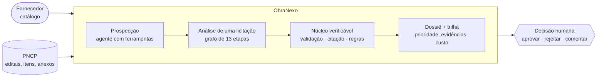

# Fluxo do agente — inputs, lógica e outputs

Documentação de apoio à banca (AKCIT Camp 2026, seção 8 do edital). Descreve o que entra no ObraNexo, o que cada
etapa faz com isso, o que sai, onde fica o estado compartilhado, quem decide, o que acontece quando algo falha e como
o sistema é observado e avaliado. Tudo aqui corresponde ao código em `src/obranexo/` na data de 24/10/2026; a tabela
de etapas e o fluxograma são gerados pelo próprio grafo que executa a análise (`obranexo grafo --formato md|mermaid`).

## 1. Em uma página

| | |
|---|---|
| **Problema** | Um fornecedor de material elétrico não consegue achar, ler e conferir item a item as licitações do PNCP dentro do prazo. |
| **Inputs** | (1) o catálogo do fornecedor (planilha JSON/CSV/XLSX ou ficha técnica do fabricante lida por IA); (2) licitações do PNCP ao vivo, pela API pública — edital, termo de referência e anexos (PDF, DOCX, XLSX, ZIP) e a lista de itens; (3) a pergunta do usuário (UFs e horizonte de prazo para a prospecção, ou uma mensagem no chat). |
| **Lógica** | Dois níveis. **Agentes de fronteira** com loop de ferramentas decidem o que buscar, abrir e analisar (Prospecção, Assistente). **A análise de uma licitação** é um grafo fixo de 13 etapas em que a IA interpreta e investiga (Analista Técnico, Especificador, Investigador, Verificador, Planejador) e um **motor de regras determinístico** decide a compatibilidade. Toda proposta da IA passa por três portas antes de virar fato: validação por tipo e faixa, citação conferida no documento e veredito por regra. |
| **Outputs** | Veredito por item (COMPATÍVEL, PARCIAL, INDETERMINADO, INCOMPATÍVEL ou fora do portfólio), cada requisito com a evidência (documento, página, trecho literal verificado), prioridade 0–100, dossiê comercial em Markdown com próximos passos e riscos, ranking justificado da prospecção, e a trilha completa: eventos de cada etapa e cada chamada de modelo (agente, modelo, tokens, custo, latência). |
| **Decisão final** | Humana: o usuário aprova, rejeita ou comenta cada oportunidade. Nenhum agente envia proposta ou dá lance. |



## 2. Orquestração: quem chama quem

Não há framework de agentes. A orquestração é código Python explícito, por dois mecanismos:

- **Sequência declarada (grafo).** A análise de uma licitação é uma lista de nós em `agents/pipeline.py`, declarada
  como dado em `GRAFO` (`agents/grafo.py`): cada nó tem nome, agente, modelo, condição para rodar, e os campos do
  estado que **lê** e **escreve**. É esse objeto que executa a análise (`GRAFO.executar(ctx)`), nó a nó; um nó
  condicional que não se aplica é pulado e isso fica registrado na trilha da análise ("Etapa não se aplica (…)").
  A ordem é do código, nunca do modelo.
- **Loop de ferramentas.** Prospecção, Investigador e Assistente escolhem o próprio caminho: o modelo pede uma
  ferramenta, o código executa, valida e devolve o resultado (ou um erro em texto), e o ciclo repete até o agente
  chamar `concluir`, acabar o limite de passos ou o orçamento de tokens. O histórico fica no objeto `Conversa` do
  cliente de LLM (`llm/client.py`), no formato de cada provedor.

A Prospecção e o Assistente disparam a análise completa pela ferramenta `analisar_a_fundo`; a análise, por sua vez,
chama o Investigador (um loop) dentro do grafo. Por que mais de um agente e não um só: cada um tem um contexto,
ferramentas e um orçamento próprios — o Analista Técnico lê itens em lote com o modelo barato, o Investigador
navega anexos com ferramentas e orçamento limitado, o Verificador só audita — e isso é o que permite testar e
observar cada parte isoladamente.

## 3. A análise de uma licitação, etapa por etapa

Gerado por `obranexo grafo --formato md` a partir de `GRAFO`. "Lê" e "escreve" são campos do estado compartilhado
(seção 4). "Quando" é a condição do nó; "sempre" roda em toda análise.

| # | Etapa | Quem | Lê (inputs) | Faz (lógica) | Escreve (outputs) | Quando |
|---|---|---|---|---|---|---|
| 1 | **Carregar contexto** `carregar_contexto` | regras | `empresa.produtos`, `analise.contratacao`, `analise.itens` | Cruza a empresa com a contratação, define o modo (LLM ou determinístico) e o orçamento de tokens. | `analise.modo`, `analise.log` | sempre |
| 2 | **Coletar documentos** `coletar_documentos` | regras | `analise.documentos`, `analise.itens` | Extrai o texto por página de PDF, DOCX, XLSX e TXT; abre ZIPs e torna cada arquivo citável; cada item do PNCP vira um documento virtual. | `indice`, `analise.documentos` | sempre |
| 3 | **Analista Técnico** `extrair_itens` | analista_tecnico · LLM (extracao) | `analise.itens` | Extrai os requisitos de cada item (potência, tensão, CCT, IP, seção…): regras pt-BR sempre; o modelo complementa em lotes de até 10 itens. | `analise.requisitos`, `analise.evidencias`, `analise.itens.categoria_inferida` | sempre |
| 4 | **Filtrar relevantes** `filtrar_relevantes` | regras | `analise.itens`, `empresa.produtos` | Mantém os itens das categorias que o catálogo cobre; acessórios e o resto saem como fora do portfólio. | `relevantes` | sempre |
| 5 | **Especificador** `especificador` | especificador · LLM (extracao) | `relevantes`, `analise.requisitos`, `indice` | Para itens publicados só com o nome, localiza no TR as páginas que tratam deles e lê todas numa chamada; cada atributo entra com trecho conferido. | `analise.requisitos`, `analise.evidencias` | há LLM e itens do portfólio com menos de 2 requisitos técnicos |
| 6 | **Motor de regras** `casar_com_catalogo` | regras | `relevantes`, `analise.requisitos`, `empresa.produtos` | Compara cada requisito com cada produto da categoria: ATENDE / NÃO ATENDE / INDETERMINADO, agregado por item; guarda os 3 melhores produtos. Nunca usa LLM. | `analise.correspondencias` | sempre |
| 7 | **Investigador** `investigador` | investigador · LLM (agente) | `relevantes`, `analise.requisitos`, `indice` | Loop de ferramentas sobre os anexos: especificação de itens ainda pobres e exigências gerais (garantia, prazo, amostra, INMETRO); citação conferida no registro. | `analise.requisitos`, `analise.evidencias`, `analise.passos_investigacao`, `analise.lacunas`, `afetados` | há itens do portfólio |
| 8 | **Motor de regras (de novo)** `recasar` | regras | `afetados`, `analise.requisitos`, `empresa.produtos` | Reavalia só os itens que ganharam requisitos com o Investigador. | `analise.correspondencias` | o Investigador trouxe requisitos novos |
| 9 | **Varrer insumos indiretos** `varrer_insumos` | regras | `indice`, `empresa.produtos` | Quando o objeto é obra ou serviço, procura nos projetos e orçamentos menções a materiais do portfólio, com evidência. | `analise.insumos_indiretos`, `analise.evidencias`, `analise.lacunas` | nenhum item do portfólio (obra/serviço) |
| 10 | **Verificador** `verificador` | verificador · LLM (agente) | `analise.evidencias`, `analise.requisitos`, `analise.correspondencias`, `indice` | Reconfere todas as citações no documento (similaridade ≥ 90), detecta conflitos entre fontes, atribui confiança; o modelo só escreve o parecer quando há pendências. | `analise.evidencias.verificada`, `analise.conflitos`, `analise.correspondencias.confianca`, `analise.revisao_humana` | sempre |
| 11 | **Qualificar** `qualificar` | regras | `analise.contratacao`, `analise.correspondencias`, `analise.insumos_indiretos`, `empresa.ufs_atendidas` | Tipo da oportunidade (publicada, planejada, indireta), comprador provável, prazo e prioridade 0–100 por fórmula. | `analise.qualificacao` | sempre |
| 12 | **Planejador Comercial** `planejador` | planejador · LLM (agente) | `analise.qualificacao`, `analise.correspondencias`, `analise.conflitos`, `analise.lacunas` | Resumo executivo, próximos passos e riscos em saída estruturada, só a partir dos fatos já verificados. | `analise.qualificacao.proximos_passos`, `analise.qualificacao.riscos`, `plano` | sempre |
| 13 | **Gerar dossiê** `gerar_dossie` | regras | `plano`, `analise` | Monta o dossiê em Markdown com itens, requisitos, evidências e plano; a análise é salva em JSON. | `analise.dossie`, `analise.status` | sempre |

"Modelo (extracao)" é o modelo barato e rápido do provedor (no Gemini, `gemini-3.5-flash-lite`); "modelo (agente)" é o
mais forte (`gemini-3.8-flash`). Sem chave de API os nós de LLM rodam só com regras (Analista Técnico, Investigador por
busca de sinônimos, Planejador por texto fixo) ou são pulados (Especificador), e a análise continua.

```mermaid
flowchart TD
  carregar_contexto["Carregar contexto<br/><small>regras</small>"]
  coletar_documentos["Coletar documentos<br/><small>regras</small>"]
  extrair_itens["Analista Técnico<br/><small>analista_tecnico · LLM</small>"]
  filtrar_relevantes["Filtrar relevantes<br/><small>regras</small>"]
  especificador["Especificador<br/><small>especificador · LLM</small>"]
  casar_com_catalogo["Motor de regras<br/><small>regras</small>"]
  investigador["Investigador<br/><small>investigador · LLM</small>"]
  recasar["Motor de regras (de novo)<br/><small>regras</small>"]
  varrer_insumos["Varrer insumos indiretos<br/><small>regras</small>"]
  verificador["Verificador<br/><small>verificador · LLM</small>"]
  qualificar["Qualificar<br/><small>regras</small>"]
  planejador["Planejador Comercial<br/><small>planejador · LLM</small>"]
  gerar_dossie["Gerar dossiê<br/><small>regras</small>"]
  carregar_contexto --> coletar_documentos
  coletar_documentos --> extrair_itens
  extrair_itens --> filtrar_relevantes
  filtrar_relevantes -->|há LLM e itens do portfólio com menos de 2 requisitos técnicos| especificador
  especificador --> casar_com_catalogo
  casar_com_catalogo -->|há itens do portfólio| investigador
  investigador -->|o Investigador trouxe requisitos novos| recasar
  recasar -->|nenhum item do portfólio (obra/serviço)| varrer_insumos
  varrer_insumos --> verificador
  verificador --> qualificar
  qualificar --> planejador
  planejador --> gerar_dossie
  classDef llm fill:#e2f4f2,stroke:#00ab9f,color:#10222f
  classDef cond stroke-dasharray:5 4
  class extrair_itens,especificador,investigador,verificador,planejador llm
  class especificador,investigador,recasar,varrer_insumos cond
```

## 4. Onde fica o estado compartilhado

Os nós não se chamam entre si nem trocam mensagens: cada um lê e escreve no mesmo objeto, o **`Contexto`**
(`agents/contexto.py`). É o "quadro-negro" da análise.

| Parte do estado | O que guarda | Vida |
|---|---|---|
| `analise` (modelo `Analise`) | itens, requisitos (cada um com evidência), evidências, correspondências (veredito por item × produto, com detalhe por requisito), conflitos, lacunas, pendências de revisão humana, passos do Investigador, insumos indiretos, qualificação, dossiê, uso de modelos, trilha de eventos | durável: salva em `data/analises/<id>.json` ao fim |
| `indice` | texto de cada documento por página, em trechos de 700 caracteres, com busca por palavras e similaridade | só durante a execução; os PDFs ficam no pacote congelado |
| `relevantes`, `afetados`, `plano` | listas de trabalho entre nós (itens do portfólio, itens reavaliados, saída do Planejador) | só durante a execução |
| trilha de chamadas | cada chamada de modelo da análise (agente, modelo, tokens, custo, latência, cache, erro) | durável: `data/obranexo.db` (SQLite), ligada ao id da análise |
| catálogo ativo, prospecções, casos congelados | memória da empresa e do mercado | durável: `data/` em JSON e arquivos |

## 5. Os agentes com ferramentas: inputs e outputs de cada ferramenta

| Agente | Ferramenta | Input | Output (o que o código devolve) |
|---|---|---|---|
| Prospecção | `buscar_licitacoes_abertas(uf, termos)` | UF e radicais escolhidos pelo agente a partir do catálogo | até 30 pregões abertos cujo objeto contém os termos (id, órgão, município, objeto, valor, prazo); vem do PNCP ao vivo, com cache de 30 min |
| Prospecção · Assistente | `ver_itens(contratacao_id)` | id de uma licitação | itens com descrição, quantidade, valor e categoria provável |
| Prospecção · Assistente | `analisar_a_fundo(contratacao_id, motivo)` | id e justificativa | baixa edital e anexos, roda o grafo da seção 3 e devolve o resultado por item, prioridade e id da análise; limitado por prospecção |
| Prospecção | `concluir(ranking, resumo)` | ranking com nota 0–100 e justificativa | só aceita ids que vieram das ferramentas; nota alta sem item compatível/parcial confirmado volta como erro com os fatos |
| Assistente | `consultar_catalogo`, `analises_salvas`, `detalhar_analise` | termo / id | produtos do fornecedor; análises já feitas; detalhe item a item |
| Investigador | `listar_documentos()` | — | documentos da licitação com páginas e se têm texto |
| Investigador | `buscar_trechos(consulta, documento_id?)` | palavras | trechos com documento e página |
| Investigador | `ler_pagina(documento_id, pagina)` | documento e página | texto da página |
| Investigador | `registrar_requisito(numero_item, atributo, valor, trecho_literal, …)` | o achado com a citação | **confere o trecho no documento na hora**: se não existe, devolve `ERRO` e o agente corrige |
| Investigador | `concluir_investigacao()` | — | encerra o loop |

O que acontece quando nenhuma ferramenta serve ou o modelo erra: o resultado volta como texto começando com
`ERRO`, o modelo tenta de novo; faltando dois passos para o limite, o sistema avisa dentro do resultado da
ferramenta para o agente registrar o que já achou e concluir. Se o agente não concluir, a Prospecção monta um
ranking de contingência pela prioridade calculada.

Limites: Prospecção 16 passos e número de análises completas definido no pedido; Investigador 12 passos mais 2 por
item sem especificação (máximo 24) e orçamento próprio de 120 mil tokens; Assistente 8 chamadas por mensagem;
orçamento da análise de 120 mil tokens mais 4 mil por item.

## 6. Quem consolida os resultados e resolve conflitos

- **Compatibilidade**: o motor de regras (`rules/compare.py`), sem LLM. Cada requisito vira ATENDE, NÃO ATENDE ou
  INDETERMINADO; por item, qualquer obrigatório não atendido → INCOMPATÍVEL; obrigatório sem informação →
  INDETERMINADO; só desejáveis falhando → PARCIAL; tudo atendido → COMPATÍVEL. "IP65 atende IP66?" tem sempre a
  mesma resposta.
- **Fontes que discordam** (edital diz uma garantia, o TR diz outra): o Verificador registra um `Conflito` com os
  dois valores e as duas citações, rebaixa a confiança do item e manda para a fila de revisão humana. Não escolhe
  por conta própria.
- **Regras × LLM na extração**: as regras sempre rodam; o que só o LLM achou entra como requisito **desejável**
  (pode deixar o item parcial, nunca o derruba sozinho). Especificação do TR com citação conferida é exigência.
- **Ranking da prospecção**: a análise técnica prevalece sobre a impressão do agente pelo objeto; se o ranking
  contradiz a análise, o erro volta ao agente com os fatos e, se ele insistir, a nota é limitada e marcada.
- **Prioridade** (0–100) é uma fórmula publicada em `agents/planejador.py`: cobertura do valor estimado por itens
  compatíveis/parciais, prazo aberto, registro de preços, venda indireta, UF atendida.
- **Decisão final**: humana, registrada em cada dossiê (pendente, aprovado, rejeitado, com comentário).

## 7. O que acontece com entrada inesperada ou falha

| Situação | Comportamento |
|---|---|
| Valor fora do tipo ou da faixa proposto pelo modelo (`cct_k = "branca fria"`, `tensao_v = 600–1000`) | descartado com registro (`rules/validar.py`); nunca derruba a análise |
| Citação que não existe no documento | recusada no registro (Investigador, Especificador) e reconferida no Verificador; evidência não verificada vai para revisão humana |
| Atributo de luminária atribuído a um relé, cabo ou disjuntor (o TR da luminária cita "tomada para relé fotoelétrico" e o modelo leva "dimerizável" para o relé) | descartado por aplicabilidade à categoria (`catalog/atributos.py: aplicavel`) no Analista Técnico e no Especificador; no Investigador volta como `ERRO` para o agente corrigir — achado na validação ao vivo de 24/10 |
| Texto do edital com instruções para o modelo | documentos e descrições entram como dados entre `<documento>`/`<item>`; os prompts mandam ignorar instruções dentro deles |
| PDF digitalizado, sem texto | item fica INDETERMINADO com a lacuna registrada ("anexos sem texto extraível") |
| Item sem especificação técnica (só cláusulas gerais) | INDETERMINADO, com explicação; nunca "atende" |
| Provedor de LLM com erro 429/503 ou sem resposta em 45 s | modelo reserva assume; o principal entra em quarentena por 10 min; tudo fica na trilha (`reserva = true`) |
| Orçamento de tokens esgotado | as etapas seguintes rodam só com regras |
| Sem chave de API | modo determinístico completo (demo e testes nunca dependem de cota) |
| Erro em qualquer etapa | a análise é salva com `status = erro` e a mensagem, com a trilha até ali |
| PNCP fora do ar | a última resposta em cache é usada e a idade dela aparece na tela |
| Ação externa (enviar proposta, dar lance) | não existe ferramenta para isso |

## 8. Memória e dados

- **Entre sessões o sistema lembra**: o catálogo ativo da empresa (`data/catalogo_ativo.json`), as análises e os
  dossiês (`data/analises/`), as prospecções, os pacotes congelados de licitações (`data/casos/`), a trilha de
  chamadas e as mensagens do chat (`data/obranexo.db`) e o cache de respostas dos modelos (`data/llm_cache/`, por
  hash da entrada: a mesma pergunta devolve a mesma resposta, sem gastar cota).
- **Conversa do chat**: cada mensagem é gravada no SQLite; se o servidor reiniciar, a conversa é reconstruída e o
  próximo turno parte do resumo das últimas 8 mensagens (o histórico no formato do provedor, com os resultados de
  ferramenta, não é guardado). O que o assistente "viu" nas ferramentas vale só dentro do turno.
- **Não há memória de longo prazo sobre o usuário**: o sistema não aprende preferências nem guarda decisões para
  recalibrar a prioridade — isso é item do plano (feedback que recalibra).
- **Dados pessoais**: a fonte são dados públicos do PNCP; o sistema não cadastra pessoas. Chaves de API ficam só no
  `.env`, nunca em log, resposta de API ou trilha. Para operar com catálogos reais de clientes, o plano prevê
  isolamento por empresa e provedores pagos (o nível gratuito do Gemini não serve para dados de cliente).

## 9. Observabilidade (LLMOps)

Cada chamada a um provedor de LLM vira uma linha na tabela `chamadas_llm` do SQLite `data/obranexo.db`
(`observability/trilha.py`): análise de origem, **agente que chamou**, versão do prompt, operação, provedor,
**modelo pedido × modelo usado**, tokens de entrada, saída e **raciocínio** (lidos da resposta de cada API:
`thoughts_token_count` no Gemini, `reasoning_tokens` no Groq, `thinking_tokens` na Anthropic), custo pela tabela
oficial de preços, latência, se veio do cache, se usou o reserva, status e erro, e o começo do prompt e da
resposta. A mesma informação sai como log estruturado (JSON por linha com `OBRANEXO_LOG_JSON=1`), junto com cada
evento de etapa.

**Como investigar uma resposta ruim**: abrir a análise → aba *Trilha do agente* → *Chamadas de IA*; localizar a
chamada pelo agente e pelo horário; ver entrada, saída, erro, se foi o reserva que respondeu, a versão do prompt;
a resposta completa está em `data/llm_cache/<hash>.json`; reexecutar a análise com o cache ligado reproduz o
mesmo resultado (temperatura 0 em todos os provedores). Pela API: `GET /api/analises/{id}/chamadas`.

**Métricas que indicam degradação** (`GET /api/metricas/llm` e tela *Qualidade*):

| Métrica | Sinal de problema |
|---|---|
| taxa de erro e taxa de reserva por modelo | provedor instável ou modelo descontinuado |
| latência média e p95 por agente | modelo sobrecarregado; análise deixa de caber na demo |
| custo e tokens de raciocínio por análise | prompt ou lote crescendo; raciocínio inflando a conta |
| taxa de INDETERMINADO por análise | extração ou especificação parando de achar atributos |
| rastreabilidade (evidências verificadas / total) abaixo de 100% | modelo reescrevendo citações |
| benchmark (`eval/run_benchmark.py`) abaixo de 100% | regressão de regras ou de prompt |

Custo: o valor é **estimado pela tabela paga** (US$ por 1M tokens, consultada em 24/10/2026); no nível gratuito do
Gemini e do Groq a cobrança real é zero. Serve para a meta de custo por análise do modelo de negócio.

**Medição de 24/10/2026** (Itaberaí, 21 itens, Gemini 3.8 Flash + 3.5 Flash-Lite, sem cache): 17 chamadas, 0 erros,
0 reservas, 165 mil tokens (152 mil de entrada, 8 mil de saída, 4,8 mil de raciocínio), US$ 0,145 ≈ R$ 0,73, 78 s
de análise, latência média 4,9 s e p95 9,9 s por chamada, 73/73 evidências verificadas. O Investigador (11
chamadas) respondeu por 68% do custo porque reenvia o histórico a cada passo — é o primeiro alvo de otimização.

## 10. Avaliação

- **Benchmark com gabarito humano** (`eval/run_benchmark.py`, `data/casos/*/gabarito.json`): Goianira e Aruanã,
  item a item e pares item × produto; 100% de acurácia e 100% de rastreabilidade na última execução.
- **Teste cego** (`docs/teste_cego_2026-10-23.md`): 5 pregões abertos nunca vistos; 10 defeitos encontrados e
  corrigidos, cada um virou teste de regressão; o gabarito humano desses casos está em andamento.
- **Testes automatizados**: `pytest -m "not integracao"` (120 testes: regras, conectores, evidência, agentes sem
  LLM, API, observabilidade, grafo) e `pytest -m integracao` (chama o provedor configurado).
- **Reprodutibilidade**: temperatura 0, cache por entrada, versão dos prompts gravada na análise e na trilha.

## 11. Como rodar e ver tudo isso

```bash
obranexo servidor                 # http://127.0.0.1:8000 · documentação da API em /api/docs
obranexo analisar goianira_pe038_2026
obranexo grafo --formato md       # esta tabela de etapas, gerada do código
python eval/run_benchmark.py
```

Na interface: **Licitações → Goianira → Analisar** mostra a trilha ao vivo; na análise, **Provas** abre o PDF na
página citada e **Trilha do agente → Chamadas de IA** mostra cada chamada de modelo; **Qualidade** mostra os
agregados de custo e latência; **Como funciona → Fluxo da análise** mostra o grafo com o que cada etapa lê e escreve.
